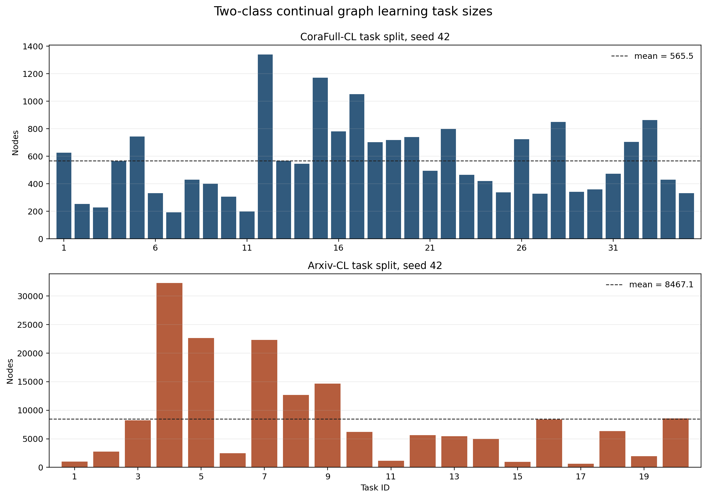

# 第 1 页 数据与问题定义

## 成员 1 的责任

- 把 CoraFull 和 OGB-Arxiv 转换为可复现的连续图任务
- 每个任务固定包含两个类别，并删除跨任务边
- 同时提供 Task-IL 与 Class-IL 所需索引
- 用顺序训练 GCN 验证数据、评测和结果保存链路

## 持续学习场景

| 场景 | 推理时已知任务编号 | 分类范围 |
| --- | --- | --- |
| Task-IL | 是 | 当前任务的 2 个类别 |
| Class-IL | 否 | 当前及历史全部类别 |

论文关注的问题是：模型依次学习新任务时，如何获取新知识并避免旧任务表示发生结构漂移。成员 1 的交付物确定所有后续实验共同使用的数据边界。

### 讲解稿 约 1 分 30 秒

我负责的是数据与持续学习场景。第一项工作是把 CoraFull 和 OGB-Arxiv 转换成统一的任务序列。按照论文设置，每个任务只包含两个类别，任务之间没有共享类别，而且任务子图不保留跨任务边。第二项工作是同时实现 Task-IL 和 Class-IL。Task-IL 在测试时知道任务编号，因此只需要在当前两个类别中判断；Class-IL 不知道任务编号，必须在所有已经出现的类别中判断，所以难度更高。第三项工作是固定随机种子、类别顺序和节点划分，让成员 4、5、6 的主模型、基线与消融实验使用完全相同的数据。最后，我用两层 GCN 做顺序训练，确认任务索引、子图构造、评测矩阵和结果目录都能运行。

---

# 第 2 页 数据划分与可复现性

## 固定种子 42 的数据规模

| 数据集 | 节点 | 边或邻接记录 | 特征 | 类别 | 任务 |
| --- | ---: | ---: | ---: | ---: | ---: |
| CoraFull-CL | 19,793 | 126,842 | 8,710 | 70 | 35 |
| Arxiv-CL | 169,343 | 1,166,243 | 128 | 40 | 20 |



## 复现检查

- 类别顺序由 `default_rng(42).permutation` 固定
- 类内节点按 60% 训练、20% 验证、20% 测试划分
- 任务编号统一为零起始，CoraFull 为 0–34，Arxiv 为 0–19
- CoraFull JSON SHA-256：`a785fa0…2204fc`
- Arxiv JSON SHA-256：`8776a04…6f4b85`
- 同一命令重复执行后哈希不变

### 讲解稿 约 1 分 40 秒

这张表给出实际解析的数据规模。CoraFull 有 19,793 个节点、70 个类别，组成 35 个任务；Arxiv 有 169,343 个节点、40 个类别，组成 20 个任务。每个类别内部使用 60%、20%、20% 的训练、验证和测试划分。图中可以看到任务规模并不均衡，尤其 Arxiv 的最大任务超过三万个节点，而最小任务只有六百多个节点。这个不平衡会影响批处理、采样和评测，所以我把每个任务的节点数、类别数和任务内边数都写入 CSV 与 JSON。接口统一采用全局零起始节点编号和零起始任务编号，并在 JSON 顶层提供成员 3、5 可直接读取的 `task_to_*` 字段。可复现性方面，种子 42 同时控制类别顺序和节点划分，两份 JSON 重复运行后 SHA-256 完全一致。论文正文和附录对 CoraFull 边数有两种写法；我按公开原始文件实际解析得到 126,842，并在报告中记录差异。

---

# 第 3 页 GCN 管线验证与交付

## 独立实验结果

两层 GCN，隐藏维度 32，每任务 20 个 epoch，学习率 0.2，seed 42。

| 场景 | AP | AF |
| --- | ---: | ---: |
| Class-IL | 1.85% | -8.95% |
| Task-IL | 56.02% | 0.01% |

Class-IL 的低 AP 和负 AF 说明简单顺序训练会严重遗忘。该实验用于验证数据管线，不是 SAOT 论文结果。

## 交付物

- `data/prepare_cgl.py`
- 两份 `data/task_splits/*_seed42.json`
- `data/data_statistics.csv`
- `results/figures/member_1/task_split_overview.png`
- Class-IL 与 Task-IL 的配置、指标、性能矩阵、日志和 checkpoint
- 成员 1 报告章节及本 3 页汇报材料

## 验收命令

```bash
python data/prepare_cgl.py --dataset CoraFull-CL --seed 42
```

### 讲解稿 约 1 分 50 秒

我用一个两层 GCN 做了独立的顺序训练验证。隐藏维度是 32，每个任务训练 20 个 epoch，种子为 42。最终 Task-IL 的平均性能是 56.02%，平均遗忘约为 0.01%；Class-IL 的平均性能是 1.85%，平均遗忘是负 8.95%。这里的数值不能和论文中的 SAOT 结果直接比较，因为这是监督式 GCN 的数据管线冒烟实验，目标是验证索引、子图、标签空间和性能矩阵是否正确。结果仍然清楚显示，任务编号已知时二分类相对容易，而在不断扩大的全局类别空间里，简单顺序训练会严重遗忘。我的最终交付包括处理脚本、两份任务 JSON、统计 CSV、任务规模图、两个场景的标准结果目录、训练日志、报告和三页汇报材料。验收时运行屏幕上的命令，检查任务统计和 JSON 哈希即可。

